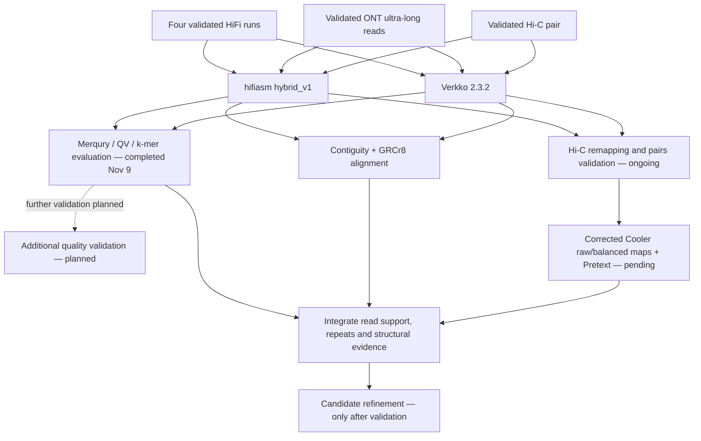
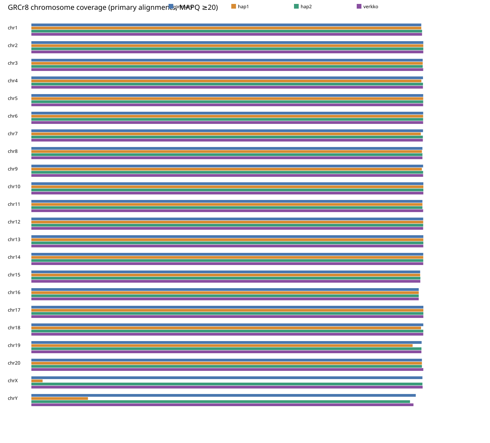

# Brown Norway Reference Genome Refinement

**Evidence-based refinement of the BN/NHsdMcwi rat genome using PacBio HiFi, Oxford Nanopore ultra-long reads, and Hi-C.**

This research compares experimental **hifiasm hybrid_v1** and **Verkko** assemblies against **GRCr8** (*Rattus norvegicus*, RefSeq [GCF_036323735.1](https://www.ncbi.nlm.nih.gov/datasets/genome/GCF_036323735.1/)). The objective is an accurate, structurally correct and complete reference—not simply a larger N50.

<!-- BEGIN CURRENT_STATUS -->
> Corrected Hi-C outputs are not yet eligible for import; mapping, pairs validation and regeneration have separate status gates.
<!-- END CURRENT_STATUS -->

See [PROJECT_STATUS.md](PROJECT_STATUS.md) for the dated scheduler snapshot and [scientific caveats](docs/INTERPRETATION.md) before interpreting differences.

## Research objectives

1. Compare assembly continuity, k-mer accuracy and completeness.
2. Validate chromosome structure using reference alignments, Hi-C and independent long-read support.
3. Evaluate centromeres, telomeres, satellites, segmental duplications and unresolved repeats.
4. Distinguish genuinely missing or collapsed sequence from alignment ambiguity and sample differences.
5. Make only independently supported corrections; preserve all original assemblies.
6. Identify biologically justified targets for additional ONT sequencing/adaptive sampling.

## Sequencing datasets

| Technology | Dataset | Available information | Role |
|---|---|---|---|
| PacBio HiFi | SRR26381151–SRR26381154; BioSample SAMN37807429 | Approximately 114.1 Gb, about 40× using a 2.85-Gb denominator | Accurate long-read sequence |
| ONT ultra-long | Local `reads.fastq` | Approximately 262.6 Gb; read N50 approximately 79.7 kb | Long-range repeat resolution |
| Hi-C | ERR5309023; BioSample SAMN16261960 | 433,992,207 records per validated mate | Long-range assembly information and contact-map review |

**The datasets are not confirmed to come from the same individual.** They are associated with the highly inbred BN/NHsdMcwi strain; ONT individual identity relative to HiFi remains unverified. Approximate long-read quantities come from the project handoff, not a new file scan. Public accessions, local filenames and validation provenance are in [metadata](metadata/README.md). No sequencing data are stored here.

## Assembly workflow

### Hifiasm hybrid_v1

Successful job **2871178** used the experimental hybrid_v1 executable reporting **0.25.1-r942**, `--ont`, all four HiFi files via `--hf`, and Hi-C via `--h1/--h2`, with **64 threads**. ONT reads were the positional input. Runtime: **27:02:06**. This is **not standard hifiasm**; substituting an ordinary release with the same version string is not reproducible. See [methods and executable identity](assembly/README.md).

### Verkko

Successful job **2871179** used **Verkko 2.3.2**, all four HiFi runs, ONT reads and both Hi-C mates, in local mode with **64 CPUs and 700G requested memory**. Runtime: **55:46:42**. The main combined `assembly.fasta` is evaluated here, not a single haplotype. Exact submitted assembly commands are preserved under [assembly/](assembly/).

## Assembly comparison

<!-- BEGIN VERIFIED_METRICS -->
| Metric | Hifiasm primary | Verkko main | GRCr8 |
|---|---:|---:|---:|
| Length (bp) | 2,911,551,654 | 2,899,709,555 | 2,849,581,192 |
| FASTA records | 125 | 272 | 76 |
| True contig N50 (bp) | 144,104,652 | 126,563,169 | 64,250,101 |
| Scaffold N50 (bp) | 144,104,652 | 146,314,543 | 137,014,596 |
| N-run gaps | 0 | 21 | 220 |
| Gap bases | 0 | 1,049,757 | 4,130,577 |
| Merqury QV (preliminary interpretation) | 64.2134 | 58.9038 | 68.5593 |
| Solid-read k-mer completeness (%) (preliminary interpretation) | 99.7315 | 99.7451 | 99.716 |
<!-- END VERIFIED_METRICS -->

**Definitions:** true contigs are split at every N-run; scaffold statistics use FASTA records. GRCr8 has 296 such contigs; Verkko has 293; hifiasm has 125.

Hifiasm has the strongest true contiguity of these assemblies. This does **not** establish an overall best assembly.

### Latest completed Brown Norway quality evaluation — interpretation preliminary

Jobs **2871273** (HiFi k=21 database), **2871274** (GRCr8 verification) and **2871275** (Merqury) completed successfully on **9 November 2026**, with the intended assemblies and expected QV/completeness/spectra outputs verified. These are our **latest completed BN evaluations**, not unfinished work or merely older historical results. Their scientific interpretation remains **preliminary, with further validation planned**. Numerical results and figures are preserved; no later evaluation job IDs or results have been verified. See [evaluation details](analyses/merqury/README.md).

Older historical analyses are a separate provenance category. In particular, the legacy DLD1 Merqury workflow is not Brown Norway evidence; other older outputs require sample/assembly verification before comparison.

## Quality assessment and chromosome comparisons

Completed assembly-continuity and reference-alignment evaluations:
- Consistent scaffold/true-contig/gap statistics.
- Minimap2 `asm5` comparisons of hifiasm primary/hap1/hap2 and Verkko against GRCr8; chromosome tables use primary target-span unions at MAPQ ≥20.

Hifiasm hap1 and hap2 differ by about **244.02 Mb** in assembly length. Hap2 has approximately **202.02 Mb** more high-confidence X/Y reference coverage. This supports a sex-chromosome assignment imbalance, not proof of missing DNA. Chromosome 19 overlapping-contig alignments remain duplication/mapping-ambiguity candidates. [Interpretation](docs/INTERPRETATION.md) and [result index](results/README.md).

**Quality-evaluation status:** the latest November 9 BN Merqury/k-mer evaluation is **completed**, while scientific interpretation is **preliminary**. Further validation is **planned, not confirmed running**; any new methods, inputs, resources and job IDs will be recorded when approved/submitted. BUSCO, contamination screening and independent long-read structural validation also remain planned; no new results are claimed here.

## Hi-C contact-map analysis

BWA-MEM (`-5SP -T0`), pairtools MAPQ ≥30 / `5unique`, coordinate sorting and duplicate removal produce standard **1-based** `.pairs`. Corrected Cooler loading must **not** use `--zero-based`.

A documented correction separates validated original pairs from revisioned Cooler matrices and generates separately labeled **raw-count** and **ICE-balanced** maps. Overview labels and boundaries use actual Cooler bin offsets. Pretext uses original validated pairs independently of Cooler success. See [Hi-C analysis](analyses/hic-contact-maps/README.md).

The original submitted mapping jobs retain the legacy Cooler command; those legacy matrices are not approved for interpretation. Corrected matrix generation is gated on full pairs validation. Hi-C also contributed to assembly, so its validation is not fully independent.

## Repeats, missing sequence and refinement

[Repeat analysis](analyses/repeats/README.md) will examine satellites, centromeric/telomeric sequence, tandem repeats and copy-number representation. [Missing-sequence analysis](analyses/missing-sequences/README.md) will combine reference-relative signals with read/kmer support and gap/repeat context. Both are planned, not completed.

[Refinement](analyses/refinement/README.md) will require independent support, explicit versioning and before/after validation. No assembly editing or scaffolding has been performed in this repository reorganization.

## Key figures

*Primary alignment target-span coverage at MAPQ ≥20; this measures alignment spans, not base-level accuracy or proven sequence absence.*

See the [figure index](figures/README.md) for reference-span coverage plots and **latest completed BN Merqury spectra, with preliminary interpretation**. All previous figures remain preserved. Corrected Hi-C figures will be added only after validation and review.

## Reproducibility and repository updates

This is a curated scientific repository, separate from the large HPC working tree. Imported scripts are **source-faithful HPC snapshots**, with original absolute paths and resource requests retained. They are not a turnkey portable workflow; do not submit them from this checkout without reviewing paths, versions, inputs and output destinations. A historical reference-comparison script still mentions raid5; do not reuse that dependency in new work.

1. Read [reproducibility instructions](docs/REPRODUCIBILITY.md), [software inventory](metadata/software_versions.tsv), and [provenance](metadata/import_manifest.tsv).
2. Use existing validated data/results where available; obtain approval before expensive SLURM work.
3. Preview updates: `python3 scripts/sync_project.py plan --source /path/to/assemblies`.
4. Apply approved local curation: `python3 scripts/sync_project.py apply --source /path/to/assemblies`.
5. Inspect diffs and run the safety checks before staging/committing. Follow [the synchronization guide](docs/SYNCHRONIZATION.md).

No automatic job-output push is configured. The initial reorganization was merged through PR #1. Subsequent corrections use new review branches and pull requests; agents must not merge them without explicit authorization. After every meaningful completed research task, curate verified updates and propose a commit and push for explicit approval. Persistent maintenance instructions are saved in [AGENTS.md](AGENTS.md).

## Repository map

| Directory | Contents |
|---|---|
| `docs/` | Methods, interpretation, reproducibility, history and update policy |
| `assembly/` | Hifiasm hybrid_v1 and Verkko assembly scripts |
| `analyses/` | Objective-organized analysis scripts and methodology |
| `scripts/` | Curated import, safety and synchronization tooling |
| `configs/` | Explicit import allowlist |
| `metadata/` | Dataset, software, run and source-file provenance |
| `results/` | Small verified scientific tables |
| `figures/` | Selected completed figures and index |
| `.github/` | Validation workflow, review template and local pre-commit hook |

## History, citation and reuse

The existing GitHub history is preserved. The previous README is [archived as historical documentation](docs/history/README.before-20261110.md), with its unsupported MIT badge/license claim removed; the exact original remains in Git history. Its older metrics and generic commands are not verified current results. No license file was present in the recovered repository; the license remains undecided pending the owner's explicit decision. Tool references are listed in [docs/REFERENCES.md](docs/REFERENCES.md).
